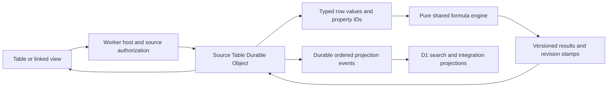

# NoteFlare computed data and relation architecture

Tables use one Durable Object authority per source table. The Worker authorizes the current user and page before sending a short-lived signed command. D1 holds disposable projections for search, tasks and integrations. A linked view stores only source table and saved view IDs; it does not acquire ownership of the source data.

The current implementation adds deterministic formulas and column calculations after the collaborative authority and saved view contracts. Future relations and rollups can extend the dependency and revision formats without changing property identities. Relation storage, cross-table execution and rollup UI are outside this release.

## Identities and versions

Table pages, properties, rows, options and saved views retain their IDs through migration and repair. Property labels are presentation names. Formula compilation resolves labels to property IDs and persists the canonical AST with `astVersion: 1`, inferred result type and dependencies. Renaming a property formats the existing AST with its new label rather than resolving the old source again.

Property configuration uses `version: 1`, independently of property revision and column generation. Formula ASTs, computed values and their source stamps have separate format versions. Unsupported configuration versions are rejected. The formula entry point is [formula/index.ts](../../src/shared/formula/index.ts); both browser previews and Worker authority use it. The evaluation context contains supplied values and property definitions. It has no fetching, networking, authorization, JavaScript evaluation or clock functions.

## Scalar values and explicit errors

Formula values are numbers, strings, booleans, null or a versioned error cell. Dates are ISO strings with an inferred date type. Arrays and arbitrary objects are unsupported inputs and produce type errors. Collection-valued properties remain distinct from scalar properties; a future relation collection must introduce an explicit value and type contract.

Missing properties, dependency failures, cycles, invalid conditions, unsupported AST versions, recursion limits and non-finite results have explicit errors. Changing or deleting a dependency invalidates dependent formulas. Errors propagate through the graph instead of silently becoming zero or an empty string.

Schema changes retype the stored AST in dependency order while retaining its property IDs. Valid result types and readable source labels update together; incompatible changes persist a validation error. Renaming a formula never reparses old property names, so reusing an old name cannot rebind its dependencies. Runtime evaluation checks supplied scalar types and prevents numeric coercion after a property changes to text. Saved views whose calculations or filters become incompatible fall back visibly until repaired.

## Revision stamps and activation

Each computed value has a source stamp with format version, table ID, table revision, schema revision, row ID and row revision. Its dependency entries include table ID, property ID and schema revision. The table authority recomputes rows in dependency order and commits results with the command revision. A property change stages a new schema generation before activation, preventing a partially updated column from becoming authoritative.

The dependency entry shape can later add source row revisions and relation traversal metadata. That extension requires a new version, permission semantics, bounded traversal and invalidation design. This release creates no reverse cross-table indexes, cross-DO subscriptions, join tables or rollup materialization.

D1 computed cells are a projected cache whose source JSON retains the authoritative stamps. Stale results must never overwrite a newer row or schema revision. Calculations operate on the entire authorized filtered set at one table revision before pagination and return typed results plus error counts. UI formatting does not change the stored value.

## Linked views and cards

A linked table block contains `tablePageId` and `viewId`. Reads require access to the host and source; writes require write access to both. Source access is rechecked after reads. Unavailable sources clear previews. Duplication retains the reference; deleting the block leaves source rows intact.

Task lists retain their fixed Task, Assignee, Status and Due date identities. Generic commands may change extra properties and saved views, but reserved task changes require a signed Task service context. Direct and linked task editors use that adapter so detail-page titles, assignment notifications and publication receipts remain consistent. Linked task commands include the host permission check in the authority's commit authorization. Request bodies cannot opt into trusted service context.

Diagram cards keep their node identity, explicit alias, `linkedPageId` and optional `linkedViewId`. A view is valid only for a table source. Preview responses are bounded and authorized independently. Persisted thumbnails use generic cards and explicit aliases so privately resolved content is not shared through image exports.

## Reader and writer rollout

Editor clients advertise schema capabilities, and existing unsupported structures make older clients read-only. New insertion uses `EDITOR_BLOCKS_V2_ENABLED`; disabling insertion keeps existing structures readable and exportable. Portable exports flatten tabs into labelled sections, export status labels as text, and use stable footnote references and anchors. Writable Markdown protects structures until a lossless mapping exists.

Table migration remains explicit and fenced. The mixed deployment supports legacy D1 tables and migrated DO tables concurrently. A DO outage never reopens D1 writes. Lease retirement follows the release closeout in [Phase 7](../roadmap/07-collaborative-tables.md), and saved views follow [Phase 8](../roadmap/08-table-views-properties.md).

## Table coverage verification

Canonical tables expose `GET /api/tables/:pageId/coverage`; linked hosts expose
`GET /api/pages/:id/linked-tables/:tableId/coverage`. Both enforce current authorization
before and after the authority call, including the linked host and selected view.
The response contains protocol/page identity, generation/revision, current columns,
views, people and edit permission. It omits rows, cursors, counts, calculations,
grouping results and relations, and performs no row-query evaluation. Query metadata
and calendar parameter validation match normal reads.

A matching proof refreshes metadata and permits reuse of the existing window. A
changed proof rebuilds its visible extent with a consistent cursor chain. Automatic
recovery preserves extent. An explicit canonical Refresh starts from the first page;
an explicit linked Refresh preserves the visible extent. Explicit canonical Refresh
retires older queued or active page requests; later Load more requests remain valid.
If a started manual Refresh becomes stale, its automatic recovery preserves the
previous visible extent; another explicit canonical Refresh still starts at page
one. Internal mutation-conflict recovery preserves pending continuation targets
and their callers, transferring them to a fresh authorized read before retrying.
Its prerequisite becomes immediately eligible after verification debt is merged,
while retaining failure history for the next genuine failure. This urgency does
not change a queued explicit canonical Refresh's first-page policy. Ordinary
heartbeat and retry deadlines remain unchanged. Query or owner retirement aborts
obsolete executions and settles their callers immediately, so a replacement
query can start without waiting for the old response. Late responses cannot
publish or requeue retired work.
Mount loads and internal recovery do not perform explicit Refresh retirement.
Heartbeats and foreground/online resumption use metadata-only verification
unless full-query recovery is required. Suspended continuations retain their
requested target and resume only after verification. Retired, hidden or offline
completions cannot restore verification. The shared reader owns one cursor restart;
further churn returns to bounded coordinator recovery.

Canonical and linked table search cache the input draft separately from the
applied query. Visible text, including IME updates, applies after a 250 ms quiet
period. Pending text disables editing and new continuation actions while keeping
rows visible. Background reads continue against the applied query. Applying a
replacement query aborts obsolete executions and requires fresh authorization;
an earlier query's successful read cannot enable editing for pending text.
Enter, clearing and explicit Refresh flush once; view/month changes immediately
apply the destination context's visible text. Owner changes use their own cache.
Unchanged text creates no read or verification work, including composition end.
Composition tracks confirmation keys only and ends on blur or input detachment.
Native composition, Process keys and legacy key code 229 cannot submit a search;
global shortcuts share the native-key classifier. Context changes do not falsely
end composition, and query timers cannot escape their context/version or effect
lifetime. Effect disconnection cancels the timer while preserving its original
deadline. Reconnection waits only the remaining quiet period, or applies the
current draft once if that deadline elapsed. Deadlines use monotonic elapsed time,
so wall-clock adjustments cannot extend the quiet period. This effect lifecycle
is distinct
from ordinary browser-tab visibility and online verification. Rendered and
imperative pending checks share an ownership predicate; imperative calls also
require a connected effect lifetime. A disconnected render snapshot can remain
unchanged while imperative calls fail closed. Retired contexts fail closed.
Temporary effect disconnection suspends the owned presentation cache
without clearing its drafts. Suspended caches reject writes and acknowledgements;
owner replacement retires and clears the old cache. An unmounted cache remains
inactive and can be garbage collected with its component.

Mutation ownership is independent of effect connectivity. Each owner-scoped
operation tracks network settlement, outcome handling and at most one plain-data
terminal outcome. Presentation activates and suspends in the same layout effect
as its private view cache. Query/load effects do not change that connectivity.
A disconnected response settles its caller immediately with a suspended result;
it does not leave a promise waiting for reconnection or final unmount. Boolean
command consumers receive no successful completion while suspended. Captured
acknowledgements and explicit success actions run once after cache activation and
read-coordinator reconnection. They do not resend the mutation.

The matching operation stays busy through connected outcome handling, including
awaited rejection recovery. Query changes cannot release it. Finalization clears
only that operation's busy state and matching busy message. Success acknowledges
only submitted snapshots, preserves newer drafts and requires current authorized
commit coverage before another mutation. Owner replacement discards retained
presentation outcomes. Final unmount leaves no reconnect-dependent caller;
private data can be garbage collected, without an immediate-erasure guarantee.
A retired operation cannot clear a newer operation's state, including after
returning to an earlier owner. Ordinary tab visibility is separate from React
effect disconnection.

Mutation rejection notices are immediate and retain review guidance without
promising an automatic mutation retry or completed recovery. Known conflict,
missing-item errors use client-owned copy. Permission errors retain meaningful
server explanations with access guidance, without inferring that an entire table
is read-only from a role-related denial. Other recoverable errors retain their
specific explanation with neutral guidance. Explanation joining normalizes sentence
separation, and permission classification uses explicit code membership.
Saved-refresh failures
follow current reads and the existing commit watermark. The save-requested
refresh receipt also associates an adopted earlier execution with that exact
pending commit. Unrelated earlier reads, retired receipts, replaced commits and
retired owners cannot replace its status. A covering verified read clears the
saved-refresh status; a successful receipt alone cannot establish coverage.
